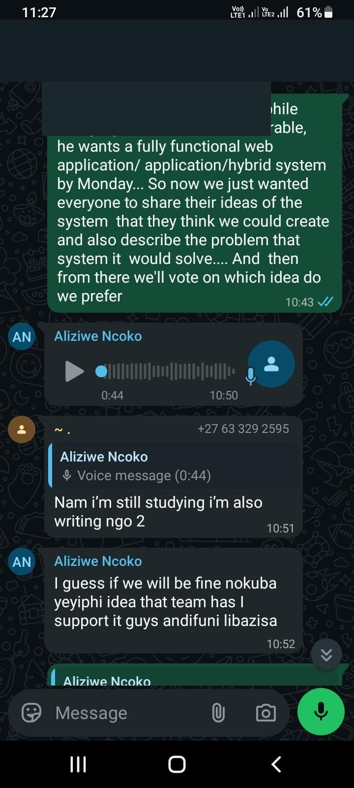
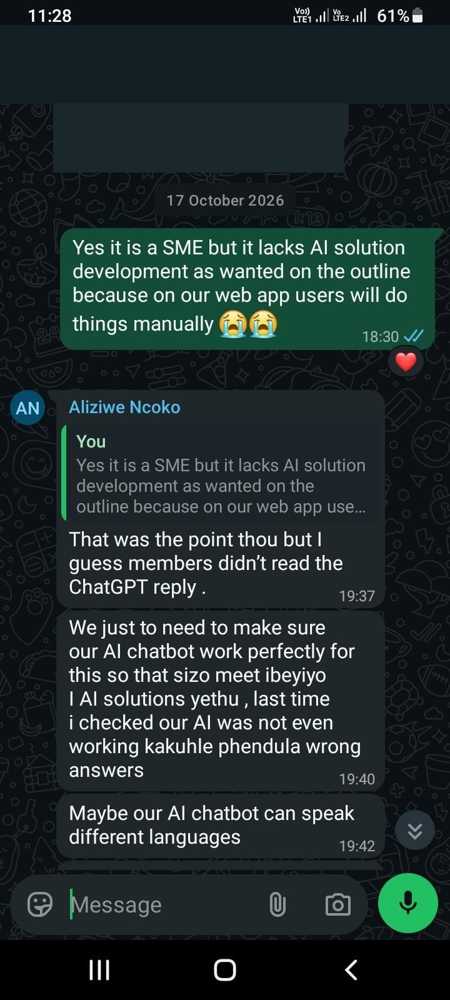
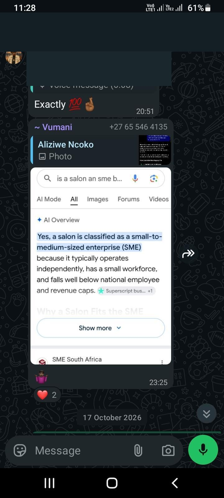
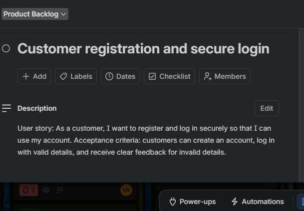
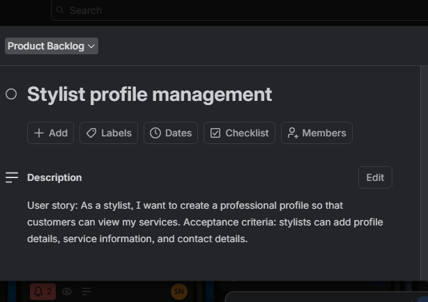
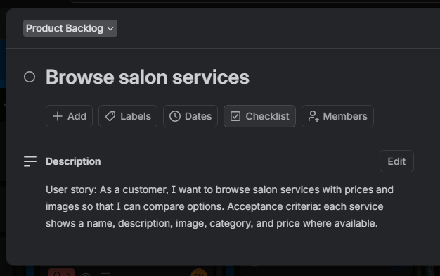
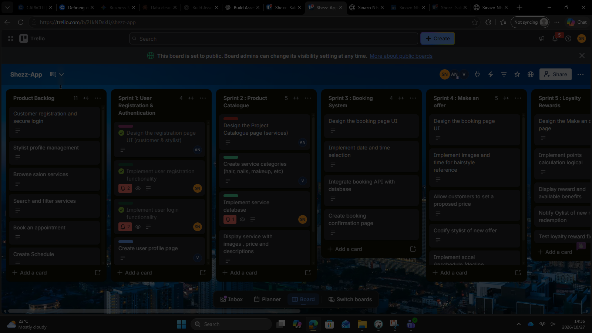
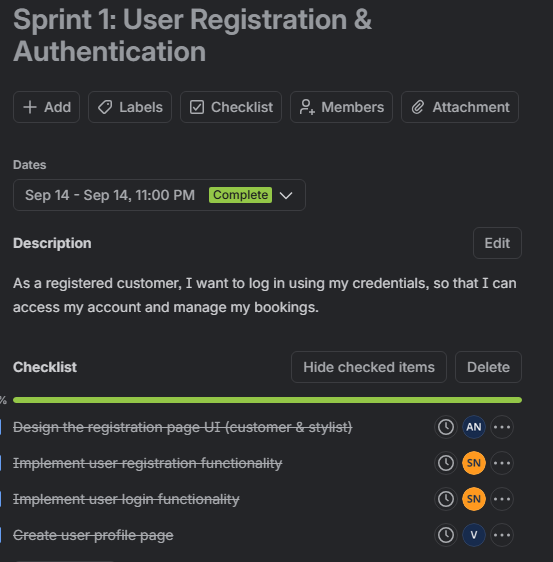

<h1 align="center">👩‍💻 Sinazo Ntsimbi</h1>
<h3 align="center">Aspiring Data Analyst | ICT Applications Development Student</h3>

  <a href="mailto:222765208@mycput.ac.za">Email</a> •
  <a href="https://linkedin.com/in/sinazo-ntsimbi-729510247">LinkedIn</a> •
  <a href="https://github.com/Sinazo35">GitHub</a>

## 📌 About Me
Final-year Diploma in ICT (Applications Development) student seeking Work Integrated Learning (WIL) placement in Data Analysis.

I have a strong foundation in SQL, database design, Power BI and Microsoft Excel. I enjoy transforming raw data into meaningful insights that support decision-making. I am detail-oriented, analytical and eager to grow in a professional environment.

## 🛠️ Technical Skills

My skills combine **data analytics**, **software development**, and **project collaboration**, with a particular interest in turning data into useful insights.

| Area | Skills and technologies |
|:--|:--|
| **Data Analysis & Visualisation** | Data cleaning, data interpretation, Microsoft Excel, Power Query, Power BI |
| **Databases & SQL** | SQL, MySQL, PostgreSQL, database design |
| **Programming & Web Development** | Java, Java Swing, Spring Boot, HTML, CSS, JavaScript, React |
| **Development Tools & Version Control** | Git, GitHub, VS Code, IntelliJ IDEA, Maven |
| **Design & Project Management** | Figma, Trello, Agile/Scrum, user stories, product and sprint backlogs |
| **Professional Skills** | Problem-solving, critical thinking, teamwork, communication, attention to detail |

**Primary focus:** Data analysis, reporting, data visualisation, and practical business insights.

## Projects

| Project | Description | Type |
|---|---|---|
| Student Residence App | Residence management system developed as a group academic project. https://github.com/Sinazo35/StudentResidenceApp.git| Group Project |
| Grocery Price Analysis | Personal data analysis project exploring grocery price trends. https://github.com/Sinazo35/Grocery-Price-Analysis.git| Personal Project |

## 🎓 Education

**High School**  
Zwelinzima S S S, KwaZulu-Natal  
📅 2019 – 2021  

**Diploma in ICT (Applications Development)**  
Cape Peninsula University of Technology  
📅 2022 – Present  

## 🌍 Languages

- English  
- Zulu  
- Xhosa  

## 🎯 Interests

- Statistical Analysis  
- Reading Tech Blogs  
- Problem-Solving (Puzzles)

## 📞 Contact

📧 222765208@mycput.ac.za  
📱 0662467536  
📍 Cape Town, South Africa  

## 🎥 Mock Interview Video

This mock interview demonstrates my communication skills, interview preparation and ability to present my experience professionally.

<video controls preload="metadata" playsinline style="width:100%;max-width:820px;border-radius:12px;background:#182b36" aria-label="Sinazo Ntsimbi mock interview video">
  <source src="/Sinazo-Mock%20interview-Video.mp4" type="video/mp4">
  Your browser does not support embedded video. <a href="/Sinazo-Mock%20interview-Video.mp4">Open the mock interview video</a>.
</video>

[▶ Watch or download my mock interview video](https://github.com/222765208/222765208.github.io/raw/refs/heads/master/Sinazo-Mock%20interview-Video.mp4)

## Reflections

### Reflection 1: Coding My CV in Markdown 

**Situation:**  
I had to create my CV using Markdown on GitHub, which was something I wasn’t very familiar with at first.

**Task:**  
My task was to format my CV properly using Markdown so that it looks clean, professional and easy to read on GitHub.

**Action:**  
At the beginning, I struggled a bit with the syntax, especially things like headings, lists and spacing. I had to practice and test different formats to see what worked best. I kept previewing my work to make sure everything looked right. As I continued, I became more comfortable and started to enjoy how simple and flexible Markdown is.

**Result:**  
In the end, I created a well-structured CV that looks neat and professional. I also gained a useful technical skill and now I feel more confident using Markdown for future projects.

### 🎥 Reflection 2: Mock Interview Experience 

**Situation:**  
I had to record a mock interview where I answered interview questions on camera.

**Task:**  
My task was to present myself professionally, answer questions clearly and show confidence as if it was a real job interview.

**Action:**  
At first, I felt nervous and unsure about how I sounded on camera. I practiced a few times before doing the final recording. During the interview, I focused on speaking clearly, taking my time and organizing my answers. I also paid attention to my tone and body language.

**Result:**  
After completing the video, I felt more confident in my communication skills. I noticed areas where I can improve, like avoiding filler words and being more direct. Overall, it was a helpful experience that prepared me better for real interviews.

### Reflection 3: Using GitHub Pages 

**Situation:**  
I needed to publish my portfolio using GitHub Pages so that it could be accessed as a live website.

**Task:**  
My task was to deploy my portfolio successfully and ensure everything displays correctly online.

**Action:**  
At first, I wasn’t completely sure how GitHub Pages works but I followed the setup steps from our subject guide and enabled it in my repository. After publishing, I continued editing my portfolio directly on GitHub and checking how the updates appeared online.

**Result:**  
I successfully published my portfolio and gained a better understanding of how GitHub Pages works. It felt rewarding to see my work live online and I now feel more confident using GitHub to showcase my projects.

---

## 💼 Workplace Project — Shezz-App

**Shezz-App** is a workplace-based software development project focused on creating a digital salon booking and customer service platform. The application helps customers browse beauty services, book appointments, upload hairstyle reference pictures and propose prices through a **Make an Offer** feature. It also includes appointment and offer tracking, a demonstration loyalty rewards system, and a mobile-friendly, installable web app experience.

The project provided an opportunity to apply workplace skills such as Agile planning, teamwork, communication, UI/UX design, frontend and backend development, testing, and deployment. Our three-member team included **Sinazo Ntsimbi (Software Developer)**, **Vumani Kamanga (Frontend Developer)**, and **Aliziwe Ncoko (UI/UX Designer)**. My technical contribution included application integration, testing, troubleshooting and deployment.

**Project links:** [Live Shezz-App](https://shezz-app.onrender.com/) · [Source code](https://github.com/Sinazo35/Shezz-App) · [Trello board](https://trello.com/b/2LkNDskU/shezz-app)

---

## Agile Assessment — Portfolio of Evidence

### Supporting Agile documents — Read online or download

| Document | Read online | Download Markdown |
|---|---|---|
| Completed Agile Team Charter | [View Team Charter](documents/Shezz-App-Agile-Team-Charter.md) | [Download charter](https://raw.githubusercontent.com/222765208/222765208.github.io/master/documents/Shezz-App-Agile-Team-Charter.md) |
| Agile Logbook, Product Backlog and Sprint Tasks | [View Agile Logbook](documents/Shezz-App-Agile-Logbook-and-Backlog.md) | [Download logbook](https://raw.githubusercontent.com/222765208/222765208.github.io/master/documents/Shezz-App-Agile-Logbook-and-Backlog.md) |

*These are Markdown document copies of the supplied Word files. They are not DOCX downloads. The logbook includes draft entries requiring verification.*

**Student:** Sinazo Ntsimbi · **Student number:** 222765208 · **Assessment:** PRP370/371/372S, October 2026

> This is an individual portfolio of evidence for a team project. Proposed tasks and draft stand-up notes are not evidence of completed work. Confirm all draft entries against Trello, GitHub and dated records before submission.

## Evidence and project links

- [Shezz-App source code](https://github.com/Sinazo35/Shezz-App)
- [Trello board](https://trello.com/b/2LkNDskU/shezz-app)
- [Live Shezz-App deployment](https://shezz-app.onrender.com/)
- [GitHub portfolio](https://222765208.github.io/)

## 1. Agile Team Charter

#### Evidence: team communication

The following privacy-redacted WhatsApp screenshots document communication relating to the workplace project. They do not independently verify attendance or completed tasks.

### Evidence — Team purpose and vision
**Mission:** Develop Shezz-App, a salon service platform that makes it easier for customers to book beauty appointments, submit hairstyle references and price offers, and access loyalty rewards.

**Success:** A usable responsive application with working core customer flows, verified testing, successful deployment and clear documentation.

### Team members and responsibilities

| Team member | Role | Responsibilities |
|---|---|---|
| Sinazo Ntsimbi | Software Developer / Agile Lead | Backend, database integration, testing, debugging, deployment, technical documentation |
| Vumani Kamanga | Frontend Developer | Responsive screens, frontend components, service integration, frontend testing |
| Aliziwe Ncoko | UI/UX Designer / Product Owner representative | User flows, layouts, visual design, accessibility, usability review |

Agile Lead and Product Owner representation are **proposed** and require team confirmation.

**Framework:** Scrum-inspired short sprints managed through Trello. Daily WhatsApp stand-ups, sprint planning, end-of-sprint demos and retrospectives.

**Working agreements:** Be prepared and punctual; update Trello; raise blockers early; give constructive feedback; review changes; test before marking work done; share evidence.

**Communication:** WhatsApp for coordination, Trello for tasks, GitHub for code and history. Routine messages should be acknowledged within one working day, subject to availability.

**Decisions:** Aim for consensus, otherwise majority vote; unresolved issues go to the lecturer/supervisor.

**Definition of Done:** Acceptance criteria met; code integrated and tested; responsive interface checked; documentation and Trello updated; team demonstration/acceptance; deployment where applicable.

**Values:** Respect, transparency, accountability, trust and learning.

**Risks:** Tight deadlines, unequal workload, integration bugs, deployment problems, connectivity and delayed feedback. Mitigate through clear ownership, small increments, backups and early testing.

**Review:** At each retrospective or when responsibilities change. Last updated 27 October 2026.

**Commitment:** Signatures/agreements for Sinazo Ntsimbi, Vumani Kamanga and Aliziwe Ncoko remain pending confirmation.

### Personal reflection — Team Charter 
**Situation:** Our three-member team needed a shared understanding of responsibilities while developing Shezz-App.

**Task:** I needed to clarify how my software-development responsibilities would connect with Vumani's frontend work and Aliziwe's UI/UX work.

**Action:** The charter documented our proposed roles, WhatsApp communication, Trello tracking, GitHub collaboration, decision-making, Definition of Done and project risks. My reported work included integration, testing and deployment; the charter itself does not prove that all planned responsibilities were completed.

**Result:** We have a written framework for coordinating the project and reviewing workload. I learned that an agreed charter should be checked against actual contributions and updated when responsibilities change. The team commitment signatures remain unconfirmed.

## 2. User Stories and Tasks

#### Evidence: user-story cards and acceptance criteria

These screenshots show the customer registration, stylist profile and service-browsing stories from Trello.

### Evidence — Prioritised user stories

| ID | User story | Primary owner |
|---|---|---|
| US01 | As a customer, I want to register and sign in so I can access my bookings securely. | Sinazo |
| US02 | As a customer, I want to browse services and prices so I can choose a suitable service. | Vumani |
| US03 | As a customer, I want to book an available appointment so I can reserve a time. | Sinazo |
| US04 | As a customer, I want a mobile-friendly interface so I can book from my phone. | Aliziwe |
| US05 | As a customer, I want to upload a hairstyle photo and propose a price so I can request a custom style. | Vumani |
| US06 | As a stylist, I want to accept, counter or decline offers so I can respond to requests. | Sinazo |
| US07 | As a customer, I want to view booking and offer statuses so I can track requests. | Vumani |
| US08 | As a customer, I want rewards for verified completed visits so I benefit from repeat visits. | Sinazo |
| US09 | As a customer, I want to install the app on my phone for convenient access. | Vumani |
| US10 | As a customer, I want accessible and consistent screens to navigate easily. | Aliziwe |
| US11 | As a team, we want to test the booking journey to find defects before release. | Sinazo |
| US12 | As a team, we want to publish and document the application to demonstrate our work. | Sinazo |

**Task breakdown:** Sinazo — backend logic, database, API integration, testing and deployment; Vumani — forms, service cards, status screens and responsive PWA frontend; Aliziwe — wireframes, layouts, usability, accessibility and visual checks.

### Personal reflection — User Stories and Tasks 
**Situation:** Shezz-App had several connected customer features, including bookings, hairstyle offers and loyalty rewards.

**Task:** I needed to translate those features into understandable user requirements and technical tasks.

**Action:** The backlog records 12 user stories and separates backend, frontend and UI/UX responsibilities. I linked the stories to proposed acceptance criteria, such as showing booking errors and offer responses.

**Result:** The breakdown provides a clearer plan for implementation and review. I learned to describe what a user needs before deciding how to build it. These task allocations are plans and must not be mistaken for verified completion.

## 3. Product Backlog

#### Evidence: Trello Product Backlog

[Open the Shezz-App Trello board](https://trello.com/b/2LkNDskU/shezz-app)

### Evidence
The 12 prioritised stories above form the Product Backlog. The supplied document's **Taskboard** lists US01–US12 under **Product Backlog**, with **In Progress** and **Completed** left empty. This is a planned backlog, not a claim that all stories were completed.

**Acceptance criteria:** Booking must handle valid and unavailable slots; offers must capture a photo and proposed price and display a stylist response; only verified completed visits count toward demo loyalty rewards; key screens must work on mobile; release requires integration tests, documentation and deployment checks.

### Personal reflection — Product Backlog 
**Situation:** We needed a way to organise all required features without losing track of unfinished work.

**Task:** My task was to help keep development requirements visible and prioritised.

**Action:** The supplied taskboard places US01–US12 under Product Backlog, leaving In Progress and Completed empty. It also records possible bottlenecks such as integration and deployment configuration.

**Result:** The backlog gives the team a shared overview of intended work. I learned that transparent task status is more useful than marking tasks completed without supporting evidence.

## 4. Sprint Backlog

#### Evidence: Sprint 1 task checklist

This screenshot shows task-level breakdown for registration and authentication.

### Evidence — Proposed allocation, 12–16 October 2026

| Date | Sinazo — Developer | Vumani — Frontend | Aliziwe — UI/UX |
|---|---|---|---|
| 12 Oct | Requirements, authentication design, endpoints | Services page structure, navigation | User journey, wireframes, design tokens |
| 13 Oct | Booking models, validation, API integration | Booking form, responsive service cards | Booking and service screen designs |
| 14 Oct | Offer handling, database integration | Photo upload and offer form | Offer mockups and error states |
| 15 Oct | Loyalty/status logic, integration tests | Status screens, mobile testing | Usability and accessibility review |
| 16 Oct | End-to-end tests, deployment checks, README | PWA checks, UI fixes | Final UI QA and screenshots |

These are **proposed sprint assignments** from the supplied document. They should not be presented as completed without corroboration.

### Personal reflection — Sprint Backlog 
**Situation:** The team needed to plan coordinated work during 12–16 October 2026.

**Task:** We needed a daily division of tasks across software development, frontend and UI/UX.

**Action:** The supplied sprint plan assigns proposed daily work to Sinazo, Vumani and Aliziwe, from requirements and designs through integration, testing and deployment checks.

**Result:** The plan shows dependencies and where integration could delay other work. I learned to schedule testing and deployment preparation alongside development. The dates and allocations remain proposed until checked against actual work records.

## 5. Agile Logbook

### Evidence — Draft stand-up notes requiring verification

| Date | Since previous stand-up | Next action | Risk / blocker |
|---|---|---|---|
| 12 Oct | Reviewed features and backlog tasks | Plan booking/authentication and agree interfaces | API endpoints and final UI screens |
| 13 Oct | Outlined authentication and booking data | Booking validation and frontend integration | Form/backend payload mismatch |
| 14 Oct | Worked on booking and offer integration | Test flows and fix errors | Database credentials and environment setup |
| 15 Oct | Reviewed booking, offers and loyalty tests | End-to-end checks and bug records | Device/browser differences |
| 16 Oct | Prepared deployment/documentation checklist | Verify live app, collect evidence, update README | Deployment configuration and bugs |

**Important:** Every row above is a draft from the supplied Agile document, not a verified contemporaneous record. Check the actual day and date labels and replace draft claims with real dated stand-up evidence.

**Walkthrough questions:** What is needed to advance the work? Prioritise booking and offers, connect design to frontend/backend tasks and test the customer journey. Is untracked work happening? Compare WhatsApp updates to Trello cards. What remains? Integration, responsive testing, deployment checks and screenshots. What blocks progress? Potential API/database configuration, integration, device compatibility and time limitations.

### Personal reflection — Agile Logbook 
**Situation:** Our project required regular progress tracking and early identification of obstacles.

**Task:** I needed to document what was completed, what would happen next and any blockers.

**Action:** The supplied logbook contains draft stand-up entries for 12–16 October, noting authentication, booking, offers, testing and deployment risks. I have kept them labelled as drafts because the document explicitly requests confirmation against actual work.

**Result:** The logbook provides a structure for reviewing progress, but not yet verified proof of daily activity. I learned to capture dated evidence during each sprint rather than reconstructing it later.

## Project links and supporting records

- **Trello:** [Shezz Salon PP board](https://trello.com/b/2LkNDskU/shezz-app) — backlog and sprint tracking. Add dated screenshots to the repository when available.
- **GitHub:** [Shezz-App repository](https://github.com/Sinazo35/Shezz-App) — source code and commit history.
- **Deployment:** [Shezz-App on Render](https://shezz-app.onrender.com/) — deployment URL; a screenshot of the Render dashboard was supplied for the portfolio and should be uploaded with private details redacted.
- **Documents:** The original completed charter and product backlog/logbook Word files should be uploaded to a `documents/` folder for download links.

## Overall reflection 
Shezz-App gave me experience connecting Agile planning to software development and deployment. I worked on technical integration and saw why user experience, frontend implementation and backend behaviour must fit together. The most important lesson was to support each portfolio claim with evidence and to be transparent about planned work versus completed work. My next improvement would be to maintain clearer daily records and collect screenshots and testing results throughout each sprint.
